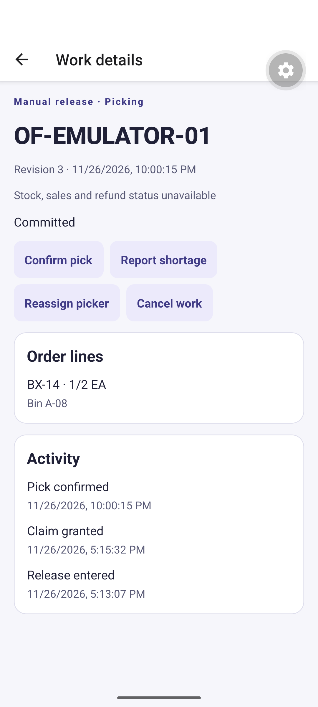

# OrderFlow Mobile

**FulfillOps mobile — warehouse pick, pack, handoff and returns inspection for staff on Android and iOS.**

| Pairs with | Repository |
| --- | --- |
| FulfillOps web frontend | [fulfillops-frontend](https://github.com/gopichand-retail-apps/fulfillops-frontend) |
| FulfillOps API | [fulfillops-backend](https://github.com/gopichand-retail-apps/fulfillops-backend) |

OrderFlow is the mobile workspace for the FulfillOps system in the [gopichand-retail-apps](https://github.com/gopichand-retail-apps) portfolio. Today it runs against its own TypeScript API and PostgreSQL database in this repository (`server/`, `migrations/`). Connecting it to the FulfillOps API is a planned integration, not a live one.

OrderFlow is a React Native warehouse workspace for releasing work from an approved manual source, claiming picks, sealing packages, recording observed handoff, and inspecting returns. The TypeScript API records claims, receipts and audit history in a dedicated PostgreSQL database.

**Status · Synthetic local IT preview.** Windows Android emulator and API evidence are in the [release record](docs/RELEASE-EVIDENCE.md). Use the debug profile for the connected local walkthrough.

## Stack

- **Mobile:** React Native 0.88, Expo SDK 58 (development client), TypeScript 6, React Navigation 7, TanStack Query 5, expo-camera, expo-sqlite, expo-secure-store
- **API:** Node.js 24 running TypeScript directly, node-postgres, Zod 4
- **Database:** PostgreSQL 18
- **Tooling:** Biome, Node.js test runner with coverage gates

## Screenshots

| Pick confirmed (Android) |
| --- |
|  |

## Android preview

A local preview build includes ARM64 and x86_64 with an embedded bundle and a development signing certificate. The connected development APK uses Metro and ADB reverse on the authorized emulator. APK files are not committed to this repository; build one locally with the [build and installation steps](docs/07-MOBILE-BUILD-AND-RELEASE.md).

## Local setup

Use workspace Node 24.15.0 and npm 11.12.1, PostgreSQL 18.7 tooling, JDK 17, Android SDK 37, NDK 27.1.12297006 and CMake 3.31.6. Give OrderFlow its own loopback cluster, staff credentials and emulator.

```powershell
npm.cmd ci
.\tools\local-db.ps1 -PgBin '<local PostgreSQL bin directory>'
npm.cmd run api
```

Enroll staff and connect the development app through the [onboarding and build steps](docs/07-MOBILE-BUILD-AND-RELEASE.md). The API uses `127.0.0.1:5761`, Metro uses `5762`, and PostgreSQL uses `5763`. Local database tests use a distinct database in the same dedicated cluster.

### Run on an Android emulator (Expo development client)

Build the debug app and start Metro from the OrderFlow root:

```powershell
$env:ORDERFLOW_DEBUG = '1'
$env:EXPO_NO_TELEMETRY = '1'
npm.cmd exec -- expo prebuild --clean --platform android --no-install
Push-Location android
.\gradlew.bat --init-script ..\tools\windows-cmake.init.gradle :app:assembleDebug -PreactNativeArchitectures=x86_64 --max-workers=2 --console=plain
Pop-Location
npm.cmd run start
```

In a second terminal, confirm the emulator, forward the API and Metro ports, then install and open the app:

```powershell
adb -s <emulator-serial> emu avd name
adb -s <emulator-serial> reverse tcp:5761 tcp:5761
adb -s <emulator-serial> reverse tcp:5762 tcp:5762
adb -s <emulator-serial> install android/app/build/outputs/apk/debug/app-debug.apk
adb -s <emulator-serial> shell am start -a android.intent.action.VIEW -d 'exp+orderflow://expo-development-client/?url=http%3A%2F%2F127.0.0.1%3A5762' com.orderflowmobile.app.dev
```

### Checks

```powershell
npm.cmd run typecheck
npm.cmd run lint
npm.cmd run format:check
npm.cmd run coverage
```

The iOS JavaScript target bundles locally. Native iOS build, simulator use and signing require a compatible Mac with Xcode. [Device matrix](docs/DEVICE-COMPATIBILITY.md) · [Expo SDK compatibility](https://docs.expo.dev/versions/v58.0.0/)

## Workspace

- `src/` contains native screens, navigation and device adapters.
- `server/`, `shared/` and `migrations/` contain the REST implementation, runtime schemas and PostgreSQL schema.
- `tests/` covers the real-engine workflow and concurrency. `docs/` records contracts and evidence.
- `docs/handoff/` preserves the two owner-supplied inputs byte for byte.
- [Architecture](docs/03-ARCHITECTURE.md) · [API](docs/openapi.yaml) · [Acceptance](docs/06-TEST-AND-ACCEPTANCE.md)

The local preview uses synthetic records. Live sales, inventory, refunds, carrier integrations and employee deployment each require reviewed ownership and environment evidence. See the [cost register](docs/INFRASTRUCTURE-AND-COST.md) for the $0 incremental operating constraint and dependency references.
