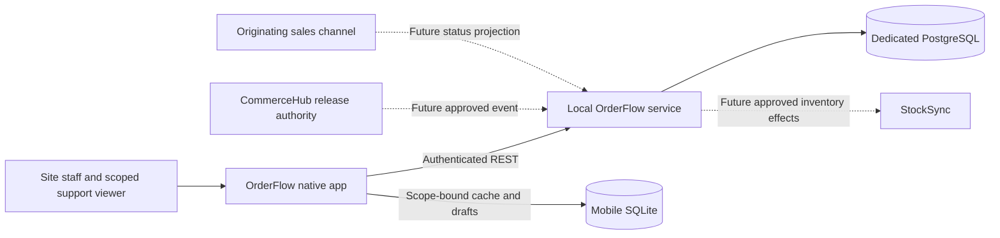
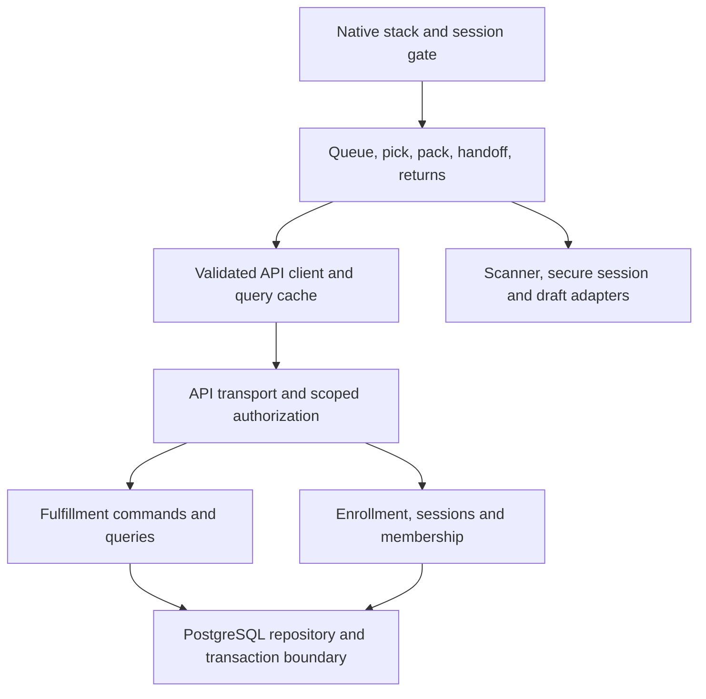
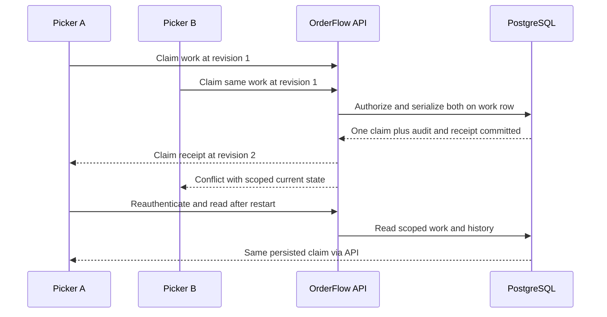

# OrderFlow architecture

[1. Observed boundaries](#1-observed-boundaries) · [2. Proposed design](#2-proposed-design) · [3. Proposed source ownership](#3-proposed-source-ownership) · [4. Runtime and risk](#4-runtime-and-risk)

## 1. Observed boundaries

Read-only inspection on November 24, 2026. The original Git repositories and IT copies represent different evidence. The OrderFlow target was empty and had no Git ancestry or configured remote. Relative source links resolve from the Retail Apps workspace.

| Entity / owner                                            | Source and observed status                                                                                                                                                                                                                                                                                                                                                 | Prerequisite to connect                                                                                                                                                                                                                                                                                                                                                                                                                                                                                                |
| --------------------------------------------------------- | -------------------------------------------------------------------------------------------------------------------------------------------------------------------------------------------------------------------------------------------------------------------------------------------------------------------------------------------------------------------------- | ---------------------------------------------------------------------------------------------------------------------------------------------------------------------------------------------------------------------------------------------------------------------------------------------------------------------------------------------------------------------------------------------------------------------------------------------------------------------------------------------------------------------- |
| Fulfillment work, legacy FulfillOps                       | Original `4d9f27b`, local main shown behind the tracked origin by two commits. Original and IT `FulfillmentModule` both inject `InMemoryOrderRepository`; `FulfillmentService` uses a process-local idempotency map. `FulfillmentController` exposes demo order/action routes and the inspection found no durable employee/site-scoped claim contract in either copy.      | Approve a durable fulfillment owner and scope real staff access. Resolve cutover under [ADR 001](adr/001-fulfillment-authority.md). [Original module](../../../FulfillOps/fulfillops-backend/src/fulfillment/fulfillment.module.ts) · [IT module](../../../.runtime/it/apps/FulfillOps/fulfillops-backend/src/fulfillment/fulfillment.module.ts) · [Rebuild evidence](../../../docs/handoffs/APP-06_FULFILLOPS_REBUILD.md)                                                                                             |
| Sales lines and financial order status, CommerceHub       | Original branch `feature/be02-order-events` at `7d65634` with local tracked and untracked work. `CommerceService.createOrderTransaction` decrements catalog stock before writing the order. The current event work validates `ORDER_PLACED`. The IT copy has distinct V4 verified customer ownership and V6 verified application sessions, which establish customer scope. | An authorized, site-scoped release event with business/source/line IDs, eligible quantities and revision is needed. Confirm whether the checkout inventory decrement remains the inventory posting under the chosen cutover. [Order transaction](../../../CommerceHub/commercehub-backend/src/main/java/com/commercehub/order/CommerceService.java) · [Event type](../../../CommerceHub/commercehub-backend/src/main/java/com/commercehub/events/OrderEvent.java) · [IT instructions](../../../docs/IT_ENVIRONMENT.md) |
| Availability, reservations and stock effects, StockSync   | Original `feature/stk-01-stable-receipt-key` at `96fbeb0` with local changes. Both inspected controllers expose reservation creation and release. There is no confirmed OrderFlow-specific consume or return disposition receipt for the proposed owner mapping.                                                                                                           | Approve inventory scope, stable shipment and return effect keys, consume and restock contracts, and reconciliation against the actual engine. [Original controller](../../../StockSync/stocksync-backend/src/inventory/inventory.controller.ts) · [IT controller](../../../.runtime/it/apps/StockSync/stocksync-backend/src/inventory/inventory.controller.ts)                                                                                                                                                         |
| Payment and refund, originating sales channel / PayBridge | Original `feature/pb-01-payment-intent-keys` at `040c5dc`. The controller has refund actions under the payment simulator domain. A return inspection supplies no finance authorization.                                                                                                                                                                                    | An authorized read-only refund-status projection with a verified source mapping. [Payment controller](../../../PayBridge/paybridge-backend/src/main/java/com/paybridge/api/PaymentController.java) · [Rebuild evidence](../../../docs/handoffs/APP-05_PAYBRIDGE_REBUILD.md)                                                                                                                                                                                                                                            |
| Physical handoff and return inspection                    | Proposed OrderFlow manual-mode data belongs to the dedicated fulfillment module. Carrier and external stock and payment confirmations remain unavailable.                                                                                                                                                                                                                  | Verify the operator/site grant and observe the actual physical event before recording handoff.                                                                                                                                                                                                                                                                                                                                                                                                                         |

## 2. Proposed design

The phone renders native views through Fabric. TurboModules expose typed native capabilities. JSI bridges JavaScript and native execution and synchronous tasks can still block the UI. Hermes runs the bundled JavaScript. Metro supports development and packages the release bundle. Use Expo local development builds with React Navigation native stack, one TanStack Query cache, cancellable reads and scoped query keys. Drafts use SQLite and current input or focus stays local to the screen. Keep a screen-level error boundary and a repository command layer for asynchronous failures. [React Native architecture](https://reactnative.dev/architecture/landing-page) · [Expo local builds](https://docs.expo.dev/guides/local-app-development/)

## 3. Proposed source ownership

| Path                                         | Responsibilities and dependency boundary                                                                                                 |
| -------------------------------------------- | ---------------------------------------------------------------------------------------------------------------------------------------- |
| `src/features/`, `src/navigation/`           | Typed route params, screens, UI state and workflow hooks. Depend on domain contracts and adapters.                                       |
| `src/platform/`, `src/data/`                 | Scan input, secure secrets, SQLite and lifecycle adapters. Validate network data and scope every cache lookup.                           |
| `public/orderflow.model.json`, `src/shared/` | Localized authored UI text, tokens and typed content adapter. Business records stay in API responses and user input.                     |
| `server/identity/`                           | Enrollment, session and membership. Provides a bound actor and access decision. Owns identity tables.                                    |
| `server/fulfillment/`                        | Owns warehouse work, release intake, status, pick quantities, packages, handoff, returns and audit. Imports identity's public interface. |
| `server/db/`, `migrations/`                  | PostgreSQL transaction helpers and versioned migrations. Use separate migration and runtime roles.                                       |
| `tests/`, `tools/`                           | Domain/native component checks, real-engine integration, tooling and artifact verification.                                              |

One local service and one dedicated database. A future effects worker can use the same application and durable journal after approval. Service decomposition needs evidence of an independent owner or capacity boundary.

## 4. Runtime and risk

| Risk                                     | Control and evidence required                                                                                                                                                                                                         |
| ---------------------------------------- | ------------------------------------------------------------------------------------------------------------------------------------------------------------------------------------------------------------------------------------- |
| Duplicate inventory ownership            | Only manual releases in the new namespace. Future connected work holds until the inventory owner confirms the reservation policy and cutover proves one posting.                                                                      |
| Device lock, revocation or lost response | Store credentials using native secure storage. Verify staff and site scope, receipt reconciliation and SQLite lifecycle before release. Defer persistent real-data drafts until encrypted storage and backup exclusions are verified. |
| Unconfirmed PostgreSQL capacity          | Dedicated local cluster and explicit ownership. Measure query load and disk, alert locally, verify restore before use with important records.                                                                                         |
| Camera, wedge and iOS compatibility      | Use the device matrix. Camera denial always leaves manual input. Vendor scanner integration requires identified hardware and permission.                                                                                              |
| Build and field limitations              | Use pinned compatible tools and test a packaged APK off Metro. Require an approved HTTPS endpoint and eligible hardware for connected field checks.                                                                                   |

[Data ownership and migration](04-DATA-AND-API-CONTRACTS.md) · [Operational privacy](05-SECURITY-AND-PERMISSIONS.md) · [Release evidence](RELEASE-EVIDENCE.md)
