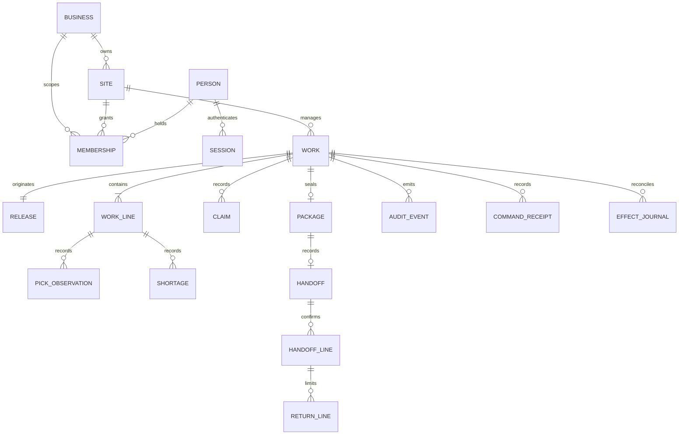
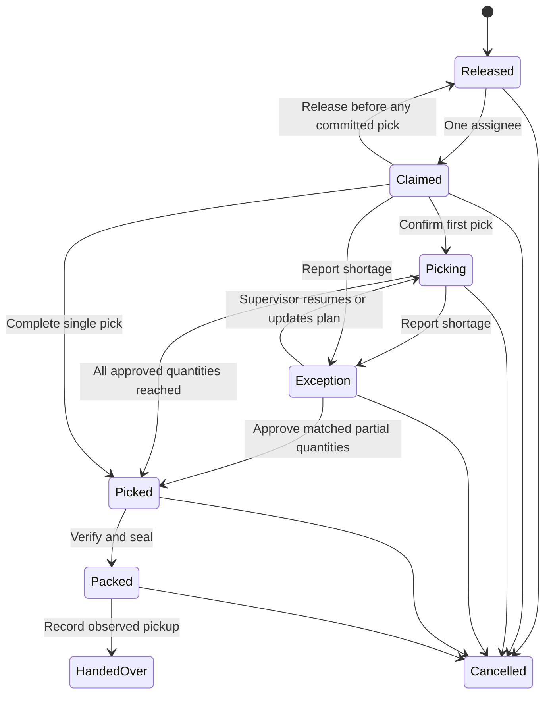

# Fulfillment data and API contract

The [OpenAPI document](openapi.yaml) covers the implemented local service. Future owner integrations and storage cutover use the proposed contracts below. The deployed schema is defined by [versioned PostgreSQL migrations](../migrations).

## Records

Use opaque UUIDs for internal IDs, integer revisions starting at 1, UTC instants with original site time zone, and positive integer units with `EA` (each). Foreign keys include business/site where needed to prevent cross-scope associations. One active claim per work is enforced by a partial unique constraint. A manual release has a unique business/source namespace/release ID and a unique business/source namespace/source order ID in the first single-release mode. The original manual release document remains with its custodian. Persist its reference, named releasing authority, revision, observation date, site and bounded line snapshots. A duplicate or stale release requires operator review. Later amendments and split releases require their own explicit contract.

Keep line IDs distinct even when SKUs repeat. Persist the SKU, bin, allowed barcode aliases as strings, requested quantity and approved or handed-over quantity as separate facts. Remaining units derive from committed observations. Enforce `0 ≤ handed over ≤ sealed ≤ picked ≤ released` per line. Approved partial quantities equal the committed quantities eligible to seal. Shortage commitments and later reopen decisions have audit events and require a newer work revision. Keep per-return received, inspected, quarantined and restock-authorized quantities distinct. Sum active reservations and committed dispositions once per original handoff line so concurrent intake cannot exceed handed-over units. Record a release of unused reserved return units with a reason.

## Work transitions

If picked quantities already exist, a supervisor's explicit reassignment preserves the current progress and audit and atomically replaces the claim. Cancellation after picking or packing records how picked units were physically secured or unpacked. A cancellation after handoff goes to return intake. Handoff and cancellation serialize on the same work row. The first mode allows one package and one handoff per work. A zero-unit partial cannot be handed over. The return progression is requested, received, inspected, and disposition recorded.

## Transport rules

Protected routes use an opaque bearer session and derive business, site and action access from active server-side membership. A site ID in the route selects the resource for an authorization check. The supervisor signs in and enrolls staff through the independent identity module. `GET /healthz` reports process liveness and `GET /readyz` checks the migration version and a bounded database connection. Error fields carry stable error codes, localized client messages and a correlation ID. Common results are 400 malformed request, 401 expired login, 403 forbidden in a known scope, 404 hidden or absent object, 409 stale/duplicate/conflict, 413 body too large, 422 invalid business input, 429 rate limit, and 503 unavailable. Authenticated responses use `Cache-Control: no-store`.

Use a default queue page size of 25 and maximum of 100. Sort priority descending, due time ascending with unscheduled last, then opaque ID ascending. Exact reference search and a status/assignment filter use bounded indexed fields. Each initial page captures up to 1,000 ordered projected records with an opaque scoped snapshot and a 60-second TTL. Bind the cursor to session, membership, business, site, filters and last position. Recheck grants on every page, and discard snapshots on grant changes or expiry. Return `truncated` when the search matches more than the capped snapshot and prompt narrowing the filters. The current detail and actions always use committed live state. Bound total snapshots and creation rate per actor and server. The API can return an expired cursor on restart and the client reloads page one. Benchmark the memory bound before tuning the cap.

## Mutation contract

All warehouse mutations take a request UUID in `Idempotency-Key` and the current aggregate `expectedVersion` when updating existing work. Derive actor, site and time on the server. Use a canonical strictly validated request fingerprint including method, resource, version and typed payload. Authorize role and resource before receipt lookup. Reserve the scoped operation key inside the transaction, lock or conditionally update the work row, validate invariants and commit the work state, audit and receipt together. An identical retry returns its original receipt and then the client fetches current work. A changed fingerprint returns `IDEMPOTENCY_MISMATCH`. A failed or rolled-back attempt never supplies a committed receipt. Preserve durable key tombstones if payloads age out. Propose a seven-day receipt retrieval window and a shorter, at most 24-hour device replay window relative to the original attempt. Old unknown operations need operator reconciliation.

The local service implements the listed warehouse commands. The operations report uses `GET /report` under the same site prefix and requires a supervisor grant.

| Route under `/v1/sites/{siteId}`                                                                                                      | Inputs and authorization                                                                                                         | Transaction and result                                                                                                                                                         |
| ------------------------------------------------------------------------------------------------------------------------------------- | -------------------------------------------------------------------------------------------------------------------------------- | ------------------------------------------------------------------------------------------------------------------------------------------------------------------------------ |
| `POST /releases`                                                                                                                      | Source release/order reference, release authority, source revision, due time, priority and full line snapshots. Supervisor only. | Validate mappings and namespace, create work/lines/audit and one receipt. Compute the digest from a canonical release payload. Conflicts cite a scoped reference when allowed. |
| `GET /work` · `GET /work/{workId}`                                                                                                    | Active grant, capped filters, scope-bound cursor.                                                                                | Return a role-limited view with state, revision, current quantities and allowed actions. History is bounded and ordered by aggregate version.                                  |
| `POST /work/{workId}/claim`                                                                                                           | Expected version, picker membership.                                                                                             | Grant exactly one claim. Conflict returns current revision, status and assignee reference only within caller's allowed projection.                                             |
| `POST /work/{workId}/claim/release` · `/claim/reassign`                                                                               | Claim ID, version and reason. Reassign additionally takes a same-site eligible staff ref.                                        | Holder may release before any committed pick. Supervisor can reassign stalled work. Return claim history and current work revision.                                            |
| `POST /work/{workId}/lines/{lineId}/picks` · `/shortages`                                                                             | Claim ID, version, SKU/barcode reference, units and source mode. Shortage needs a reason and affected units.                     | Check active claimant and exact work/line identity. Record one observation or exception. Keep authoritative totals unchanged on denied SKU or over-pick.                       |
| `POST /work/{workId}/shortages/{shortageId}/resolve`                                                                                  | Supervisor, current version, reason and wait or approve partial decision. Partial orders include the approved line quantities.   | Audit the disposition. Open shortages block packing.                                                                                                                           |
| `POST /work/{workId}/packages`                                                                                                        | Packer, version, package reference, confirmed contents referenced by line ID.                                                    | Seal only exact approved picked quantities and return a package ID and work version.                                                                                           |
| `POST /work/{workId}/handoffs`                                                                                                        | Handoff operator, packed version, package ID, business-issued pickup reference, method, observed time and explicit attestation.  | Insert one handoff and delivered lines, record server time and return the receipt. Integrated work requires upstream authorization before handoff.                             |
| `POST /work/{workId}/cancel`                                                                                                          | Supervisor, version, reason and physical disposition where units were picked.                                                    | Serialize against handoff. Release remaining eligibility per stock-owner policy only when connected.                                                                           |
| `POST /work/{workId}/returns` · `/returns/{returnId}/receive` · `/returns/{returnId}/inspections` · `/returns/{returnId}/disposition` | Version, original handoff line ID, quantities, reason, condition or disposition as appropriate to the step and role.             | Lock the original line for return capacity. Advance only legal return transitions with audit, receipt and any approved effect journal record.                                  |
| `GET /operations/{operationId}`                                                                                                       | Same actor, current site and action access, original operation ID.                                                               | Return scoped durable status and receipt. An absent receipt can also mean the original request is still in flight.                                                             |

## Events and recovery

A committed event records schema version, event ID, producer, aggregate ID/revision, business/site, action, actor ref, call correlation and UTC time. Keep audit append-only with minimal detail and redaction. Future external effects need an outbox record in the same transaction, stable producer/effect keys, bounded backoff, deadlines and supervised replay. The worker verifies the owner receipt and reconciles ambiguous results or version gaps before display. Manual mode has no external dispatch. It can record inspection and local quarantine without representing confirmed inventory or refund effects.

Proposed migrations add identity/membership schema, release/work and receipts, then additive workflow/return tables by slice. The runner records immutable version/checksum entries and obtains a migration lock. Initial rollback can restore a pre-change isolated backup. Once new writes occur, preserve records and apply compatible forward repair. Exercise clean setup, upgrade, restore into a fresh isolated cluster, retained IDs and audit totals before claiming recovery. For SQLite, version the scope/cache schema independently and preserve unsettled keys across compatible upgrades.

[Security](05-SECURITY-AND-PERMISSIONS.md) · [Acceptance](06-TEST-AND-ACCEPTANCE.md)
