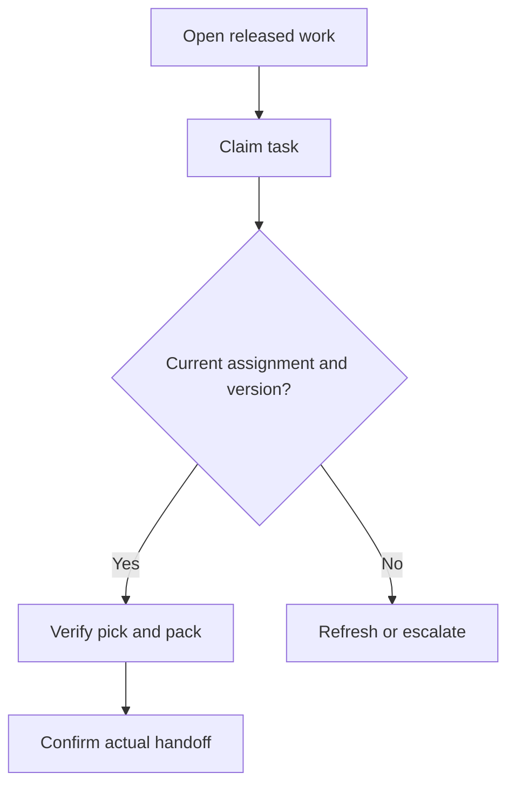

# OrderFlow Mobile — V3 product and engineering specification

**Technology:** React Native / TypeScript  
**Product objective:** Order fulfillment, picking, returns and real-time operations.  
**Inputs:** this file + the owner’s universal master/agent instruction file  
**Targets:** native Android and iOS  
**Budget:** $0 incremental spend  
**Execution:** architecture first, implementation after explicit approval; one app at a time

**Use this file** · Begin with the proposed operating design and its workflow below. Then follow the [shared engineering decisions](#engineering-and-release-decisions-for-this-specification), [numbered product requirements](#5-product-scope-screens-and-business-rules), [delivery artifacts](#8-required-deliverables-and-evidence) and [Stage A handoff](#10-stage-a-handoff).

**Review date** · November 23, 2026. The mobile product, contracts and screens are proposed. Source observations below identify existing behavior and dependencies.

## From released order to verified handoff

**Product decision.** A picker claims eligible work, a packer confirms the contents and an authorized operator records the physical handoff. A customer support viewer can answer where the work stopped. Keep the customer's order, warehouse work, stock and money under their respective owners.

**Verified source boundaries.** The original FulfillOps NestJS service in `FulfillOps/fulfillops-backend/src/fulfillment/fulfillment.service.ts` implements allocation, pick, pack, simulated ship and return transitions with process-local state. Its demo controller and in-memory idempotency cannot establish durable, scoped shared operations. In `CommerceHub/commercehub-backend/src/main/java/com/commercehub/order/CommerceService.java`, order creation already decrements local stock. The CommerceHub IT copy has separate verified customer/session migrations, including V4 and V6. Customer ownership establishes no warehouse staff role. Preserve the archived FulfillOps app. A durable fulfillment owner is a deliberate, separately approved change.

### Workflow authority and proposed commands

| Record | Owner, rights and invariants |
|---|---|
| Order/release | CommerceHub owns sales lines and financial order status. Accept a business/location-scoped eligible release once by producer/release ID and order revision. An import must have genuine authorized source, order/line IDs, quantity and explicit release authority. |
| Work/claim | FulfillOps owns warehouse work, assignment, status and history. Picker sees assigned location. Packer may seal verified picks. Supervisor can reassign a stalled claim with a reason. A viewer receives limited read-only status and timestamps. |
| Reservations and returns | StockSync owns reservation/consume/release/restock when connected. Link source IDs. PayBridge/originating sales channel owns refund decisions. Recording returned condition creates an inspection record; only eligible units go back to saleable inventory. |
| Independent use | A supervisor imports/enters a verified release document into a local, persistent fulfillment module. Label the source as manual, prevent re-import and keep upstream stock/financial status explicitly unknown. Document local pick, pack, and actual pickup signed off by a named authorized operator. A stock-dependent integrated release remains on hold until confirmed. |

Prefer one TypeScript FulfillOps module with PostgreSQL locally for shared claims. Mobile SQLite holds only scoped read cache and recoverable draft pick observations. Stage A must select the sanctioned service copy, physical install target and exact contract. Side-by-side independent mode is appropriate only for a distinct business/source namespace. Do not run simultaneous writable authorities for the same work.

Proposed state machine: released → claimed → picking → picked → packed → handed over. Shortage moves a line to exception; supervisor chooses a documented partial-release plan or waits. Prohibit substitutions by default. Release/reassign claim explicitly. Cancellation before handoff invalidates future transitions; after handoff open a return. Conflicting cancel/handoff requests must serialize on the same work version. Return lines pass requested → received → inspected → disposition recorded. Preserve quarantined, restock-authorized and rejected quantities separately.

| Proposed API | Server behavior and durable receipt |
|---|---|
| List/detail work; import eligible release | Cursor over (priority, due time, ID) within server-authorized site, stable filters and snapshot. Deduplicate import atomically, report unknown mappings, reject stale order revision. Return visible line quantities, version and allowed actions. |
| Claim/release/reassign | Expected work version, actor and location from session. One conditional update grants the claim. Losing claimant sees fresh owner/status and can choose next work. Process restart preserves claim. |
| Confirm pick / short line / pack | Validate expected line ID, SKU, quantity, unit, eligible and remaining quantities and claim owner. Versioned line updates protect concurrent actions. Packing requires all lines picked or explicitly dispositioned. Return accepted lines and authoritative work revision. |
| Confirm pickup/handoff | Require packed state and a verified in-person occurrence, timestamp, method and operator. Use a business-generated pickup reference, minimize personal information. Store handoff and event atomically. An absent carrier is displayed as unavailable. |
| Open/inspect return | Reference original handoff and line, reason, quantity and condition. Lock the line and prevent cumulative approved/received quantities exceeding delivered quantity including pending claims as policy specifies. Keep stock adjustment request separately pending with original effect ID. |

Persist work, unique release mapping, lines, claims, pick observations, packages, handoff, return lines, audit and effect journal. One transaction commits a transition and its outbox fact. Reconciliation worker retries a downstream effect with a stable key, verifies owner receipt, records failed delivery for operator replay and never marks it confirmed on timeout. Rebuild projections by producer/event ID and aggregate version. Before any inventory cutover prove which owner consumes stock once, including cancellation/release compensation, and disable the conflicting local posting through approved coordinated change.

### Task-oriented screens

Use a work queue with a pick list as the main task surface. Light ink #202137, indigo #403B86, surface #F6F6FB. Dark surface #171726 with lavender #C4C0FF. A short pick has a labeled warning and unresolved quantity. Use tabular quantity pairs, 28-unit current-line type and a steady confirmation area. One-column queue → details on phones, queue/detail side by side when both remain legible. Never hide the shortage action in a gesture.

| Screen | Interaction and failure state |
|---|---|
| Shift/site and queue | Select visible facility, show queued/claimed/exception work with source and due time. Filter by assignment, scan or type an order reference. Distinguish empty queue from upstream unavailable. |
| Work detail/history | Lines, allowed actions, revision, order and fulfillment statuses with source and time. Claim on server. A stale deep link reauthorizes before rendering. |
| Pick / scan | One large current line, bin, SKU and remaining quantity. Wrong SKU and excess quantity retain progress. Manual and camera input plus optional keyboard wedge feed one state machine. Deliberate repeat restarts the scanner. |
| Shortage/cancellation | Capture affected units, reason and proposed resolution. Return focus to the line. Show a pending reconciliation until supervisors decide. |
| Pack/handoff | Review package contents and partial disposition, then seal. Separate physical handoff confirmation. If disconnected, show a saved draft and require online revalidation before final action. |
| Return intake | Show delivered, returned and eligible quantities, condition, reason and disposition. Expose refund status only with a confirmed authorized source. |
| Supervisor workbench/sync | Show stale claims, open shortages, integration failures and age; safe replay by original effect ID. An optional notification carries an opaque work reference and requests current scope. |

**Operational reports.** Report oldest eligible unclaimed work, committed picks and shortages by location, elapsed release-to-handoff for completed jobs and unresolved return dispositions. Specify time zone, inclusion rules and whether upstream confirmations are pending. A device tap or queued observation does not count as completed work.

**Acceptance sequence.** P0 import an authorized two-line release, race two employees claiming it on different connections, restart service, observe the same winner. P1 record a partial pick, deny an excess scan, hand off only the approved quantity and re-read durable history from a second user. P1 concurrently cancel and hand off; exactly one legal transition wins. Drop the response after commit, retry with the original key, verify one receipt. An offline pick draft survives process death and requires fresh ownership after reconnect. P2 submit two returns for the last eligible unit, verify one authorization and no automatic refund; block cross-site list, item and export attempts. A test of integrated stock effects must include the actual inventory owner or mark that integration blocked.



Use typed work-ID deep links, a paged server query cache, and SQLite for draft picks. Measure the time until a second employee sees a newly claimed task under polling. Add subscription-based invalidation only if the observed delay exceeds the approved target.

### React Native runtime selection

Prefer a locally built Expo development client with a version-compatible RN release, typed React Navigation native stack, and Hermes. The development binary includes native modules; the signed release embeds its JavaScript bundle. Verify lockfile, SDK matrix and release behavior on both targets. Use bare RN only when a required integration cannot be made reproducible through supported build configuration, e.g. a verified vendor extension. New Architecture uses Fabric for native rendering and TurboModules for typed native modules. JSI is the JavaScript/native interop interface; synchronous work there can still block interaction. Capture evidence from native build configuration and device traces. Use platform adapters for scanner, storage, lifecycle and permissions only where the product needs them. [React Native architecture](https://reactnative.dev/architecture/landing-page) · [Expo development builds](https://docs.expo.dev/develop/development-builds/introduction/)

Select one query cache for server responses; keep transient form/focus state local. Persist only necessary scoped drafts/cache in SQLite; keychain/keystore protects secrets, not an ordinary unencrypted database. State the actual file encryption, OS backup/transfer exclusions, lock-on-background and purge behavior. Cancel obsolete reads and guard against late responses. Scope each navigation link to an allowlisted route, reload membership and check object access on open. Keep notification payloads opaque. Provide a screen-level error boundary with safe recovery and handle asynchronous failures in the command/repository layer. Test with RN Testing Library plus the real backend and a no-fee native E2E runner or recorded device workflow. For release, profile cold launch, action feedback, screen reader use and scrolling a real paginated list on named hardware.

### Contract example and compact layout

Proposed `POST /v1/work/{id}/claim` accepts `expectedVersion` and an idempotency key; derive actor and site from the grant. Return `workId, claimId, assigneeRef, revision, allowedActions`, or a scoped 409 showing that someone else claimed the work. `POST /v1/work/{id}/lines/{line}/picks` carries `claimId, productRef, pickedEach, expectedVersion`. `POST /v1/work/{id}/handoffs` requires packed revision, actual method and observed confirmation. Use separate `/returns` and `/returns/{id}/inspections` commands. Never convert a successful pick or event acknowledgment into a shipped, restocked or refunded status.

```text
[Facility · work reference · claim state]
[Bin]  [Active SKU / required unit]
[Picked / required]   [Scan or type]
[Shortage]             [Confirm pick]
```

### Measurement plan for claim and pick

Aim for visual feedback within 250 ms p95, and a fresh reply or actionable timeout within five seconds on the agreed local network. Test a queue of 1,000 work items. These are proposed design budgets. Confirm the workload and threshold with the owner. Record device, OS, build mode, sample size, network conditions and actual p50/p95, including offline, low-memory and recovery results. Run only against an isolated synthetic dataset. Keep business commit latency distinct from local feedback.

## Engineering and release decisions for this specification

### Authority, design and documentation

Read the complete owner-supplied **Universal Application Agent Standard v2.6.2** and this file explicitly, including the end of both files. Record actual version, byte count and SHA-256, especially if automatic instruction loading has a size cap. This review used the owner's Pictures/AGENTS.md. These two files contain the mandate. Repository source, schemas, build tools, authorized configuration and devices are technical inputs. Do an architecture/design handoff first, stop for the owner's approval, then implement and verify only the selected app. Review is complete when decisions are recorded; app delivery is complete only against the accepted operational scope.

The domain design above defines the proposed first operating mode and takes precedence over open alternatives in the retained product requirements. Downstream agents must distinguish evidence, proposal and approval. For any shared change identify the original frontend/backend root, current branch/revision, local edits, owner and scope. Obtain separate cross-repo authorization. Follow the universal Git baseline once repository change is in scope and preserve concurrent changes. A historical IT pass or proposed platform contract cannot open a shared endpoint for employee use.

Generate the full PRD, screen designs, ERD, permission/egress matrices, OpenAPI or local repository contract, migration and rollback plan, requirement-to-test table, device evidence and operations instructions from these inputs. Keep one canonical README and architecture guide, with the named V2 deliverables as cross-linked, nonduplicated sections or separate purpose-specific files when expressly required. Learning labs and their separate hints/solutions have their own audience. During design compare three current official/product references and two possible layouts against the actual job, and record reasons for the chosen direction. Proposed visual tokens are starting values; measure both themes, Dynamic Type, 200% scaling, keyboard, TalkBack and VoiceOver on packaged UI.

Use one bundled public/orderflow.model.json for all authored UI copy, validation, accessible names, alerts, export labels and licensed references, including translations. One typed adapter checks schema version, duplicate keys, locale and interpolation parity, falls back to the bundled default and tests RTL, long strings and offline startup. Business data, role grants and server facts are outside this resource. Apply a shared 4/8/12/16/24/32 spacing scale, 48 dp Android and 44 pt iOS minimum intended targets. On available window width below 600 logical units use one column, at 600–839 consider a rail, at 840+ consider a second pane. These are proposed transition points. Long text, safe areas and keyboard can force an earlier single pane. Forms retain entered values on recoverable errors, announce the first invalid field and return focus after dialogs.

### Identity, consistency and operational support

For connected modes authenticate a public native client using a verified issuer with external system browser, authorization code and PKCE S256, exact registered redirects, state and OIDC nonce where applicable. Validate issuer, audience, expiry and membership on the server. A native client carries no confidential client secret. If adopting existing session/CSRF APIs, document protected cookie storage, expiry, rotation, CSRF binding, logout and resume; never disable their guards for mobile. A standalone multi-user service must have genuine local enrollment, adaptive password hashing, expiring/revocable sessions and server-enforced membership. Bind caches, file grants, notifications, draft/outbox keys and cursors to environment, business, location and person. Recheck current permissions before resuming or replaying. First-owner bootstrap is single-use, authorized, auditable and disabled after enrollment. Setup, revocation, account recovery and last-owner protection must be tested. Private single-device books use the explicit local privacy/recovery model in their product design. [Native OAuth guidance](https://www.rfc-editor.org/rfc/rfc8252)

Define each command's inputs, allowed transition, transaction, expected version, idempotency scope, request fingerprint, returned record/version and retry window. Reauthorize duplicate requests before returning the original receipt. Preserve one scoped operation ID through timeout, process death and replay; reject different payloads under the same key. Separate draft, server-accepted/pending, committed, conflict and rejected states. Treat a timeout after submission as unknown outcome: query receipt or replay the same key after authentication. Maintain a bounded local queue with per-entity ordering, deadline, bounded backoff, jitter, terminal reason and operator review. Background work is opportunistic; foreground sync remains the required recovery route. Hold uncertain or unauthorized operations for reconciliation. Before a device changes hands, lock with access to pending work restricted to the originating user or explicitly resolve/discard it after an informed decision. Purge scoped caches, credentials, notifications, exports and encryption keys at sign-out. Deleting the only authoritative local ledger requires explicit confirmation and a separate recovery path.

Every connected response has a stable error code, field errors where relevant and correlation ID. Record who can read, write, export, subscribe, view attachments and run jobs. Apply defaults of bounded pagination, size/time limits, parameterized queries, minimal projections, sanitized errors, conditional concurrency and atomic uniqueness. Keep service identity and credentials off-device. A compatible existing REST API wins over a second GraphQL interface unless the app shows a measured benefit. Use stable typed adapters to translate local keys to (business, source, external ID). Ensure effect and fact publication commit together when another domain depends on delivery. Consumer deduplicates by producer/event ID and reconciles gaps by revision or owner snapshot. No shared-table writes. Retain one writer during migrations and document the exit path from independent mode: export, preview ID mapping, reconcile counts, freeze old writes, prove new reads, then switch.

For operated services, log correlation, outcome, version, duration and queue age, with private data redacted. Define a named human support role, alert threshold and recovery action for failed core commands, high pending age, ingest lag or low free capacity. Specify retention by data class with the owner, and locate exports/backups by tenant. Test isolated restoration plus compatible old/new readers, then measure recovery point and recovery time from actual attempts. Record health, readiness, graceful shutdown and forward repair under the target OS and engine. On-device-only products surface local storage/export failures and provide a recovery workflow without remote telemetry. Approve recovery/availability targets before using real business records.

### Quality and native release proof

Use frozen dependency installs, pinned native/JDK/SDK versions, explicit environments, minimum CI permissions, scoped secret/license/runtime checks, lint/format/types, contract tests and behavioral tests. Apply universal new-code coverage targets individually where supported (90% lines/statements/branches/functions, 95% for critical auth, stock, money and transitions, 90% changed code). Report measured tool metrics/omissions independently. Use true separate DB connections for overlapping commands. Record denied tenant/role/resource/field, duplicate and changed payload, disk/network failure, interrupted commit, replay, backup/restore and privacy evidence. Validate UI → actual service or local repository → durable record → cold launch / second authorized client → displayed confirmation. Distinguish synthetic fixture, local connected service, staged external service and physical field run.

Propose a permanent package/bundle ID owned by the organization, e.g. com.owner.orderflow, with separate .dev/.it suffixes. Confirm namespace ownership, signing custody, upgrade history and collision checks before first signed delivery. Ship original icon, adaptive icon and splash for each platform. Set environment-specific endpoints, declared native usage descriptions, permitted links and scoped permissions. Keep the release working with Metro/Flutter tooling stopped. Offline-only releases disable remote updates and network permission in the signed artifact. For connected release device testing use an approved authenticated HTTPS route with a trusted certificate. Loopback services in this workspace stay private; a debug-only, authorized USB mapping may test development connectivity. It cannot prove field connectivity. Never open a demo service on the LAN to make the install test pass.

Run two clean local builds with pinned inputs. Verify package identifier, version, signing certificate, SHA-256 and bundled content. Compare output digests; explain reproducibility differences if timestamps or signing prevent bit equality. Run a signed previous APK → newer APK upgrade on a disposable authorized device, verify the signature identity, unchanged record IDs, draft recovery and schema migrations. Record exact commands/tool versions for Fresh install, adb install -r, cold launch, offline/lifecycle, primary flow and recovery. Restrict release signing to the owner. Native iOS verification needs a compatible Mac/Xcode, simulator or authorized iPhone; record separate simulator/device/signing results, entitlements and any free-signing expiry. Inspect device/region/install-channel policy before promising no-fee distribution. Google's free limited-distribution path targets small authorized audiences and describes up to 50 devices; enterprise availability requires its own eligibility evidence. [Android signing](https://developer.android.com/studio/publish/app-signing) · [Android distribution](https://developer.android.com/developer-verification/guides/limited-distribution) · [Apple account](https://developer.apple.com/help/account/basics/about-your-developer-account)

Track each capability separately using **proposed** (design), **implemented** (reachable source path), **tested** (recorded result against a named environment and build), **field-verified** (observed authorized physical operating workflow), **blocked** (dependency, owner and recovery step) or **unverified** (evidence missing). A failed test stays visible with inputs and actual result. Record actual feature/requirement ID, command or manual steps, revision, device, expected/observed outcome and link to redacted evidence. Publish or deploy only with separate authorization.

### Capacity gate for this app

The ceiling is $0 incremental across the existing ten apps, seven mobile clients and their tooling. Prefer existing hardware, local free/open-source runtimes, protected loopback engines, local builds and an owned backup destination. No paid fallback. Compute available capacity per provider, billing scope and quota dimension as limit minus measured existing usage, reserved headroom and already approved allocations. Unknown capacity means zero new allocation. Account-plan snapshots age; before any remote use verify commercial eligibility, actual billing linkage, cap behavior, model/region, usage, backup, egress, storage, compute, auth, telemetry and CI allowances. Stop dispatch before exhaustion, keep recoverable local work and label unavailable services. No card, automatic conversion, paid overage, trials, enrollment, cloud build, publishing or automatic upgrade. Vercel Hobby's personal or non-commercial use terms exclude commercial retail operations. Local database operations and native builds do not entitle the app to free capacity on a hosted plan.

## 1. Execution contract and product integrity

Read the universal master prompt / agent instruction file supplied by the owner and this application specification in full. This document is the application-specific scope; it is not a substitute for repository security policies. If the universal instruction is missing, report that fact and use the explicit requirements here to produce a proposed plan; do not invent its contents. The owner has an existing ten-product retail platform. This is one proposed additional mobile product or mobile client, not authorization to rewrite, rename or modify any other application. Inspect available existing contracts and source of truth before creating services. If a dependency is inaccessible, document its contract as proposed and build only approved standalone functionality. Never claim cross-app integration is live until verified.

Start with discovery and design: inspect workspace, available tooling, existing products, platform identity, APIs, schemas, provider access and applicable instructions; record evidence. Produce a product requirements document, screens and flows, architecture, data/API contracts, decision log, scope, milestones, test plan and cost register. Stop for owner approval before source changes unless the owner explicitly authorizes implementation. After approval implement only this product in vertical slices, then stop for release approval. Keep progress and handoff on disk. Never modify other apps, production databases, provider billing, or deploy publicly without explicit authorization. Preserve existing work. Prioritize correctness, accessibility, security, business value and maintainability over speed; avoid needless frameworks.

Use genuine native mobile UI on both target platforms. Both Android and iOS must be targeted. A real save must persist; statuses must reflect actual operations. Use empty/onboarding/error states, no fabricated success or invented metrics. Test fixtures and isolated test environments are valid only outside real business execution paths. Use product language that identifies offline, unavailable and disconnected capabilities. Use original assets and authorized, synthetic non-sensitive records in development and IT. Handling real customer or employee data later requires explicit operational, privacy and access approval. Do not make claims of real customers, employment experience or store availability without evidence.

## 2. Mandatory zero-cost operating policy

Incremental spend across the entire platform, including all mobile apps, is $0. No subscriptions, paid tools/APIs, usage-based overages, payment cards, auto-pay, trial conversions, or paid build/store services. Existing Gemini, Supabase, Vercel and Oracle access does not establish free eligibility. Neon may be evaluated if justified. Verify current official plan terms, intended-use eligibility, quotas, billing state, enforceable no-overage behavior and combined platform consumption before activating any resource. No potentially billable calls or provisioning if unknown. Do not change account or billing settings; record required owner actions. Budget alerts are not spending caps. Use local free/open-source tooling and genuinely non-billable infrastructure first. If a service cannot be verified as non-billable, leave it disconnected with a truthful status or implement a local alternative. No paid fallback. Future paying customers do not automatically authorize spending; separate express owner approval is required.

Prefer local Android SDK/emulator and physical Android testing, with free local builds. For iOS, use an available Mac with Xcode and simulator; free personal-device signing has limitations and may require periodic reprovisioning. Windows cannot compile or run the iOS simulator locally. Do not buy a Mac, use billable cloud build minutes, enroll in developer programs, publish to stores, or bypass signing restrictions. If Mac/iOS device or required entitlements are unavailable, document the exact blocker and label iOS build/runtime verification as pending; do not treat source compatibility as a successful build. Use free Android installation artifacts where appropriate; public store distribution is outside the current cost mandate. Verify current Apple/Google/Expo rules before any distribution.

Record provider, official link and verification date, plan, allowed use, shared quotas, overage behavior, billing certainty, quota controls, fallback and migration trigger in `docs/INFRASTRUCTURE-AND-COST.md`. Implement server-side quota controls for remote services; if exhausted, disable safely and notify, never invent responses or auto-upgrade. No production payments, banking connections, SMS or other fee-bearing operations. Use manual business record entry or approved non-billable internal functionality instead.

## 3. Shared platform architecture and mobile engineering baseline

Design for one or more small-business locations with scoped staff access. Reuse approved identity and backend APIs if available; do not introduce redundant authoritative stores. Map business/location/user IDs, canonical entity ownership, data lifecycle, write authority, read views, API versioning and integration contracts. Prefer REST/OpenAPI or existing approved interfaces; use real-time subscriptions only where justified, re-fetch authoritative state after reconnect. Offline data is a local cache or explicit durable local source for standalone mode, not a competing source of truth. If standalone mode is approved, support migration/export, distinct local identity and deterministic reconciliation; do not silently merge records. Design server authorization, least privilege, tenant isolation, input/schema validation, idempotency for mutation retries, transactional invariants and audit records. Mobile UI is never the authority for roles or critical business rules. Use secure OS credential storage, short-lived sessions where applicable, redacted logs, HTTPS for remote data, logout cache cleanup, minimal device permissions and data retention. Do not put service-role keys, LLM keys or secrets in app bundles; `.env.example` must contain placeholders only. Minimize sensitive data on-device and protect it appropriately; do not promise encryption where not implemented.

Design screens for phone and tablet, safe areas, keyboard, large text, screen readers, focus, reduced motion, platform conventions, dark/light themes and usable error recovery. Include loading, empty, offline, stale, forbidden, validation and retry states as appropriate. Avoid needless animations and background work; use permission explanations and manual alternatives. Use platform-supported APIs with least privileges. Background execution is best-effort and OS constrained; refresh on foreground/reconnect, never promise continuous execution. Include accessibility and real-device verification checklist. Capture measurable performance only from actual profiling (device/build/dataset noted). Keep dependencies minimal, maintained, licensed and version-compatible; pin lockfiles; document version choices and official docs consulted. Never add tech merely for keyword coverage.

## 4. React Native implementation architecture

Use React Native with TypeScript strict mode, native components, hooks and feature-based modules. Prefer Expo with local development builds/prebuild where compatible; evaluate bare RN only for justified native capabilities. Expo Go may be used for early checks but is not proof that custom native modules or release builds work. Check the selected SDK/RN compatibility matrix and current New Architecture support. Explain Fabric, TurboModules, JSI, Hermes, Metro and native build pipelines accurately; do not add an unused bridge simply for a resume. Select Expo Router or React Navigation (one routing solution), typed route params, auth guards and deep-link validation where appropriate. Use TanStack Query for server state if warranted; keep ephemeral state in hooks, shared client state in one justified store (Context/Redux Toolkit/Zustand). Use runtime schema validation and typed API adapters; avoid redundant global copies of server state. For durable offline workflows use SQLite and explicit migration/outbox logic; do not store tokens in AsyncStorage. Use compatible native SDKs for camera, local notifications, file handling and accessibility only when required. Define lifecycle, cancellation, subscriptions, list virtualization, memoization where measured, error boundaries and retry rules. Choose Jest and React Native Testing Library for behavioral tests plus an eligible free E2E runner or documented manual tests on real devices. Include Android Gradle and iOS Xcode signing/debugging notes; record which commands ran and their outcome. Suggested structure: `src/features/`, `src/domain/`, `src/data/`, `src/platform/`, `src/shared/`, `src/navigation/`, `tests/`, `docs/`; adapt to approved router and workspace. Do not force a separate backend if existing services own the domain.

Official references to verify before choosing versions: https://reactnative.dev/docs/getting-started ; https://reactnative.dev/docs/testing-overview ; https://reactnative.dev/docs/accessibility ; https://docs.expo.dev/develop/development-builds/introduction/ ; https://docs.expo.dev/build-reference/local-builds/ ; https://developer.apple.com/help/account/basics/about-your-developer-account .

## 5. Product scope, screens and business rules

Roles: fulfillment associate, supervisor, customer support viewer. Screens: order queue, search/filter, order details, pick list, scan confirmation, packing, fulfillment status, cancellation/return request, activity history, sync status. No live payment processing, paid carrier label generation or fee-bearing external calls.

- OF-01: authorized order queue and detail with truthful state, timestamps, item quantity and location; server pagination, pull-to-refresh and scoped realtime invalidation.
- OF-02: claim order/pick task atomically; verify item by scan/manual entry; track partial picks, shortages, substitutions only with explicit approved rules, and packing. Concurrent claims yield clear conflict handling.
- OF-03: order state machine e.g. received → reserved → picking → packed → fulfilled; cancellation/return branches with permissions, reasons, inventory actions owned by inventory service. Adapt to actual canonical order model rather than introduce conflicting statuses. Never mark fulfillment or payment as completed without authoritative confirmation.
- OF-04: return intake with quantity validation, reason, condition, supervisor review and linked inventory action; track refund status as external/manual record only if legitimate authority exists. Do not perform financial transfers.
- OF-05: local work queue supports cached reads and draft picks where appropriate; consequential finalization requires server confirmation. Replay idempotently with stale-version detection. Support app foreground refresh and authorized deep links to order details.

## 6. Domain contracts and technical focus

Map `order`, `order_line`, `reservation`, `pick_task`, `shipment_or_handoff`, `return_request`, `return_line`, `status_event` to existing owners. Document read/list contracts, claim and state-transition endpoints with expected version and idempotency key, event schemas and permission matrix. Inventory reservations/releases require actual owner service and tested contract; if unavailable, block integrated transitions instead of simulating success. Use paginated virtualized lists, query invalidation, realtime reconnection, scanning, deep-link routing, mutation cancellation and conflict UX. Explain optimistic UI vs committed status and how out-of-order events are handled. Use no artificial background promises.

## 7. Milestones and acceptance tests

A: state machine/contract; B: order queue and details; C: picking/packing and persistence; D: returns and inventory integration; E: release checks. Verify simultaneous claim attempts, wrong SKU, over-pick, cancel vs fulfill race, duplicate mutation, stale subscription event, unauthorized access, offline finalization refusal, return quantity not exceeding eligible items and accurate audit. Trace one order from canonical API through picking and accepted fulfillment, with linked stock effect only if integration is implemented and verified.

## 8. Required deliverables and evidence

Create app-specific, cross-linked documentation, with requirement IDs and proposed/approved/verified status. Use relative links, exact source symbols and actual commands/results. Create at least:

- `README.md`: product purpose, screenshots captured from running app (when available), prerequisites, Android/iOS setup, run/build/test commands, environment template and known limitations.
- `docs/00-START-HERE.md`, `01-PRODUCT-REQUIREMENTS.md`, `02-USER-FLOWS-AND-UX.md`, `03-ARCHITECTURE.md` (Mermaid context/component/sequence diagrams and folder map), `04-DATA-AND-API-CONTRACTS.md` (ERD, migrations, OpenAPI/schema where applicable, source of truth), `05-SECURITY-AND-PERMISSIONS.md`, `06-TEST-AND-ACCEPTANCE.md`, `07-MOBILE-BUILD-AND-RELEASE.md`, `08-PERFORMANCE-AND-ACCESSIBILITY.md`, `09-IMPLEMENTATION-BACKLOG.md`, `10-PROGRESS-AND-HANDOFF.md`, `INFRASTRUCTURE-AND-COST.md`, `adr/`.
- `docs/11-PORTFOLIO-EVIDENCE.md`: skill → implementation reference → verification → what the owner can explain; distinguish learning projects from professional employment; include original interview practice questions and evidence-based project descriptions, no fabricated metrics.
- Platform integration register: entity, source owner, API/event, scope, version, pending prerequisites, authorization and verification status. Store approved schemas and migration artifacts in appropriate locations; no secret values.

For each milestone, implement vertical slices with tests. Report what is implemented, verified, partially complete, blocked or excluded. Do not use screenshots as evidence of backend persistence. Every critical operation needs positive and negative tests; verify app restart, error recovery, denied permissions, accessibility, offline behavior as specified, and no unexpected external costs. Demonstrate on Android and verify iOS independently when hardware/toolchain exists. Do not claim release-ready across both platforms if checks remain blocked. Record build artifacts and hashes where feasible; never publish or sign using paid accounts without approval. Finish with requirements-to-tests matrix, code review, remaining risks, owner setup steps, zero-cost gate and approval request. Do not start another app automatically.

## 9. Operational product and delivery contract (implementation requirements)

These additional requirements refine sections 1–8 and apply throughout architecture, implementation and release. They are included here so this file is independently usable with the owner's universal agent instructions. The START-HERE index and other app prompts are not required inputs. Resolve contradictory instructions explicitly before implementation; no interpretation may relax the zero-spend or safety requirements. Use approved existing repository contracts when accessible; if missing, state the missing prerequisite and propose an interface for approval rather than inventing a live integration.

### 9.1 Architecture approval package

Before code changes, provide a concise decision-ready package: product scope and exclusions, primary user workflows, exact existing source/API ownership, backend deployment choice, data model, screen designs, permission matrix, integration dependencies, device support, costs, milestones, acceptance tests and risk register. Label each item observed, proposed, approved or verified. Include the screen-by-screen specification and API/migration plan below. Select versions compatible with the actual workspace and confirm current official documentation and licenses; do not hardcode unsupported version assumptions. If the universal file is unavailable, do not guess its contents. If a prior design is approved, inspect it and reconcile these requirements without duplicating documentation. Get approval before implementation and separate approval before remote deployment, shared schema changes or release. Implement only this app. Use a dedicated branch or owner-approved isolated workspace; preserve unrelated changes and do not force-push.

### 9.2 UI/UX system and screen design deliverables

Design a real employee/business operations product, not a website shrunk to a phone. Use native stack/navigation conventions on iOS and Android, a consistent restrained brand palette with semantic success/warning/error colors, clear typography, spacing tokens (4/8/12/16/24/32 dp as a starting grid), light/dark themes, and accessible touch targets (target at least 48 dp Android / 44 pt iOS). Respect dynamic type/font scaling, safe areas, orientation and keyboard. Meet WCAG 2.2 AA applicable contrast targets, and test TalkBack/VoiceOver when available. Do not rely on color alone; use labels, icons and text. Prioritize quick task completion, low cognitive load, and one-handed use; on compact handhelds, avoid horizontal scrolling for routine tasks. Use native lists and input controls; avoid decorative dashboards, unnecessary gradients and animation. Choose icons/assets with verified free licenses; never copy an employer's brand or screenshots.

Define navigation hierarchy, tab vs stack rationale, role-based landing routes, back behavior, destructive-action confirmation, error recovery and persistent status. Produce per-screen annotated wireframes in Markdown/Mermaid or local free tooling (no paid design service required), including narrow handheld and larger tablet variants, component IDs, spacing, typography, field labels, input types, validation, API bindings, transitions and empty/loading/permission-denied/offline/stale/error states. State what action is primary and what constitutes success. Show meaningful real values when records exist and honest onboarding/empty screens otherwise. Do not remove honest status or failure disclosures in pursuit of polish. Capture actual implementation screenshots after building; separate them from proposed wireframes. Do not infer that generated designs are already implemented.

### 9.3 Frontend code standards

Use the framework-specific structure in section 4. Keep domain logic independent of presentation; feature modules own screens, view models/hooks and feature-level tests; shared UI primitives use tokens; data adapters handle transport and serialization; platform adapters isolate permissions/scanners/storage. Avoid cyclic dependencies, global mutable state, duplicated business validation, unnecessary abstractions and inline network calls in render/build. Use strict TypeScript or Dart sound null safety and analysis rules; document exceptions instead of suppressing errors globally. Validate external responses at runtime, centralize typed error mapping, cancellation, timeouts, session handling and bounded retry with jitter for safe operations. Make async loading and optimistic/pending state explicit; do not show success before an authoritative commit. Store tokens in OS-backed secure storage and never embed service credentials. Commit lockfiles, lint/format configs, environment templates, setup scripts, and test commands. Run lint, typecheck/analyze, unit and integration checks in CI within verified free allowances or locally. No paid package, proprietary SDK or unused framework just for skills coverage.

### 9.4 Backend implementation contract

Identify the actual canonical domain owner in the existing retail platform. Reuse its authorized endpoints and identity rather than create a competing source of truth. If no suitable backend exists, design and request approval for a small modular backend (existing Node/TypeScript or Java/Spring service where justified, or verified Supabase functions/RPC with RLS); use a real relational store for multi-user operations. Shared operations require durable state in the responsible domain backend. For any API, specify route/method, request/response schema, auth scope, tenant/location enforcement, validation, transaction boundary, idempotency behavior, pagination, concurrency/version strategy, status/error codes, audit fields and tests. Example error envelope: `code`, safe `message`, optional field errors, request correlation ID; follow existing approved contracts when different. Never trust caller-provided role or tenant membership without verification. Use parameterized SQL/ORM, constraints, indexes, reversible/forward-safe migrations, documented backup/restore and non-sensitive structured logs. No broad service-role access from clients. For Supabase, test RLS under ordinary authenticated roles, not only elevated admin. Define health/readiness checks and local developer setup. Prefer reusing existing services; if a shared change is necessary, document the cross-repo impact and get separate approval. A connected backend is not optional for claiming shared employee operations are working.

### 9.5 Real-data onboarding and integration

A new business must be able to start from an empty account, establish an authorized owner and location, add permitted users/roles, configure operational records and perform the primary workflow using records it actually creates or imports. Reuse existing onboarding and master data services where available; otherwise provide approved local/business-scoped input or import with validation, preview, deduplication, explicit commit and an error report. Never ingest employer/customer records without authorization. Demonstrate real entry/import, persistence and retrieval with owner-entered synthetic business records in local acceptance. Field verification requires permission for the actual records and operating environment. Persist successful writes and retrieve them after app restart and, for shared features, from a second authorized session/device. Reconcile deletions, visibility changes and stale caches. Explain where data lives, who owns it, how it is updated and how it can be exported or removed. No pre-populated fabricated live dashboards or random values. A local development backend with genuine persistence is valid verification, but is not evidence of live remote operation; distinguish local, staging, connected and field-verified statuses. For unavailable external integrations, provide honest status and permitted manual workflow when possible. Never substitute a fake success response. Do not claim company-wide integration until cross-app tests pass against actual authorized services.

### 9.6 Retail device compatibility and field readiness

Create a device matrix: actual owner Android phone, emulator with supported API levels, compact rugged handheld/tablet if available, and iPhone/iOS simulator when available. Record device model, OS/API version, screen size, CPU architecture, scanner type, permissions, network and app build. Choose minSdk/targetSdk and iOS deployment target based on verified dependencies and actual supported devices; don't claim universal scanner support. Test compact screens, font scaling, soft keyboard, portrait and supported orientation, low memory/process recreation, foreground/background, Wi-Fi loss/reconnect, airplane mode, battery restrictions, rapid taps, shift handover, logout and shared-device cache cleanup. Device must not require a development server for release operation. Camera scanning and hardware wedge input are distinct: where barcode workflows exist, support manual input and camera, and evaluate a keyboard-wedge scanner (focus, suffix/Enter, repeated frames, leading zeros, duplicate handling). Vendor intent/SDK integration is conditional on actual device and compatible free SDK, owner permission and test hardware; document pending hardware tests instead of promising all Zebra/Honeywell devices. Do not provision MDM, enroll company hardware or install anything on an employer device without explicit authorization from its owner/admin. Do not request device administrator permissions. Explain enterprise distribution/managed device restrictions as future considerations, not a current paid requirement.

### 9.7 Native Android APK and iOS release verification

Produce a reproducible Android release APK (not merely an Expo Go QR link or web preview). Establish a stable application ID, versionCode/versionName, icons/splash, permissions, environment selection and release signing plan. Use a local owner-controlled signing key for authorized release builds, never commit keystores/passwords, do not generate or overwrite owner keys without approval. Document actual local build command for the chosen framework/Gradle flavor (e.g. RN/Expo prebuild + Gradle assembleRelease, or `flutter build apk --release` after signing configuration); verify it matches the project and runs without a paid service. Record artifact path, build type, signature verification where available, SHA-256, toolchain versions and build logs. Provide owner-approved install steps using a personal authorized device and Android SDK `adb install` when available, or the OS-approved APK installer; do not bypass managed-device restrictions. Check fresh install, upgrade preserving eligible data, cold launch without Metro/dev server, login/onboarding, primary workflow, persistence, network recovery, uninstall/export implications. Use a reachable HTTPS backend for remote features; emulator loopback/localhost is not a real-device deployment address. Local development endpoints must be restricted to development builds; do not weaken release transport security. For iOS document bundle ID, Xcode project/workspace, signing and simulator/device build steps; perform actual tests on available eligible Mac/device only. Pending iOS or handheld verification is an explicit release gate. No paid store memberships, paid cloud builds, public store publishing or automated payments under the current policy. Android sideloading on approved devices is not a claim of public store availability.

### 9.8 Verification gates and handoff

Add requirement-level acceptance evidence for architecture approval, real frontend-backend vertical slice, persistence, roles/tenant denial, concurrency/idempotency, offline/recovery, accessibility, performance, security, device build/install and cross-app integration. Test with a fresh business/location and authorized records; for shared operations, confirm a second authorized client sees the committed result and unauthorized users cannot. Include regression tests for failure cases; inspect production code paths for fabricated responses, hardcoded live records or unintended fixture imports. Use actual commands, artifacts, paths and results; distinguish not run, blocked, failed and passed. Never call a product ready for employee deployment until required environment, security, device and field checks are satisfied. A successful build alone is insufficient. Create `docs/DEVICE-COMPATIBILITY.md`, `docs/REAL-DATA-ONBOARDING.md`, `docs/SCREEN-DESIGN-SPEC.md`, `docs/RELEASE-EVIDENCE.md` and an updated requirements traceability matrix in addition to section 8 deliverables. Record support/rollback procedures, limitations, owner setup steps, and how to verify the first real business workflow. Stop for owner review before moving to another app.

### 9.9 Hard zero-cost release gate

Maintain the $0 incremental budget across all apps and shared services. Before use, verify official current terms, intended use (including commercial/employee use if applicable), hard free limits, billing state and whether usage can ever become billable; alerts alone do not prevent charges. Never enroll a card, enable auto-pay/billing/overages, start auto-converting trials, provision paid services, use billable model tokens or add paid fallback. Prefer local SDKs and open-source components, and existing eligible free services only after verification. For any unclear or ineligible provider, stop that integration, document the reason and propose a genuinely non-billable alternative. No paid upgrades even if the product gains customers until explicit owner approval. If free infrastructure cannot safely support actual business operations, state the constraint; do not disguise it by changing labels or weakening security.

### 9.10 OrderFlow-specific operational blueprint

Design a queue with status/priority/location and server pagination; order detail shows authoritative lines and activity. Picking workspace has large item/quantity/scan controls, shortage exception reason and progress. Packing/hand-off screen has a deliberate confirmation; returns screen shows eligible quantities, condition, reason and approval state. Distinguish packing from shipping/actual handoff, and refund record from actual payment. Use authorized orders created by canonical sales/order app; if missing, request an approved order-entry dependency, do not fabricate orders or fulfillment. Proposed API contracts: list/detail, claim/release pick, confirm line, pack, fulfill/handoff, return request/review; define state/version constraints, transactional claim and reservation ownership, outbox/event deduplication if appropriate. Capture inventory reservation/release/return side effects via actual approved service with failure reconciliation. Support camera/manual and optional wedge scanning as in device contract. Acceptance: authorized order created, two employees attempt claim (one succeeds), pick and pack actual lines, confirm authorized fulfillment, verify status and stock effect where integrated, then request valid return and observe actual approved state. Block consequential finalization if backend cannot confirm; no paid carrier/payment services.

## 10. Stage A handoff

Perform Stage A only unless explicit implementation authorization accompanies this document. Read the universal instructions and inspect the workspace. Output evidence-backed product requirements, actual integration opportunities, architecture choices, exact zero-cost setup, screen map, data/API contracts, learning plan (when applicable), milestone backlog and blockers. Identify which work belongs to this app and which requires separate approval. Stop at the architecture approval gate. Once approved, use this same file as the implementation contract; persist progress and do not mark unverified capabilities complete.
